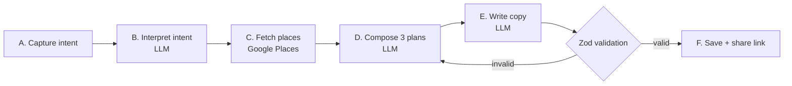

# Yalla PRD (v1)

> Product Requirements Document. Source of truth for what we build and why.

| Field | Value |
|---|---|
| **Product name** | Yalla (working name) |
| **Status** | v1 build |
| **Platform** | Mobile-first web app (PWA). No native app in v1 |
| **Markets** | Lebanon first (Beirut, Batroun, Jbeil, Tripoli, Broummana, Jounieh). Dubai in v2 |

## Table of contents
1. [Overview](#1-overview)
2. [Problem](#2-problem)
3. [Solution](#3-solution)
4. [Success metrics](#4-success-metrics)
5. [How the product works end to end](#5-how-the-product-works-end-to-end)

---

## 1. Overview

**One-line pitch:** Say what you feel like doing this weekend, get 3 ready plans in 5 seconds, share with your friends.

**Target user:** 20 to 40 year olds in Lebanon, planning weekends with friends or partner, tired of scrolling Instagram and arguing in WhatsApp.

## 2. Problem

Deciding what to do on weekends with friends is slow and painful.

**Current flow:**
1. Open Instagram, scroll saved posts
2. Send 5 options in the group chat
3. Wait 2 hours for votes
4. Someone says *"yalla khalas any place"*
5. End up at the same place as last week

| Metric | Today |
|---|---|
| Average decision time | 45 minutes |
| Satisfaction | Low |

## 3. Solution

A mobile web app that takes **one input** (text or chips) and returns **3 ready plans**. Each plan is a path of 2 to 3 stops with real places, times, and a one-line reason per stop. User picks one, shares a link, done.

**Target decision time: 15 seconds.**

## 4. Success metrics

> TODO: define (e.g. time to first plan, share rate, plans generated per user per week).

## 5. How the product works end to end

### 5.1 User side

User opens Yalla on their phone Saturday morning. They have 3 hours free, no idea what to do, and don't want to argue with friends.

1. Tap a preset (*"Sunday hike"*) or type *"Italian lunch in Batroun then coffee"*
2. Five seconds later: 3 ready plans on screen. Each plan is a path:
   - 2pm pasta at place X
   - 4pm cortado at place Y
   - 6pm sunset at place Z
3. Tap one, hit **Share**, paste the link in WhatsApp. Done.

**Total time: 15 seconds instead of 45 minutes.**

### 5.2 System side: the 6 jobs

| Job | Name | What it does |
|---|---|---|
| **A** | Capture intent | Frontend collects what the user said: free text, selected chips, time, area. Standard form state |
| **B** | Interpret intent | Turns messy human input into structured machine input (see example below) |
| **C** | Fetch candidate places | Queries Google Places API per slot. Returns 20 to 50 real places per slot with name, rating, hours, price level, coordinates |
| **D** | Compose 3 plans | Picks places and order, makes the 3 plans feel different (classic / new / adventurous), adds alternatives for each stop |
| **E** | Write human-facing copy | Plan title (*"Batroun slow Sunday"*), one-line reason per stop (*"wood-fired pizza, opened in March"*), the vibe line |
| **F** | Deliver and persist | Validates output, saves to database with a short share ID, sends JSON to frontend, renders cards |

**Job B example.** Input: `"Italian lunch in Batroun then coffee"`

```json
{
  "slots": [
    { "category": "italian_restaurant", "area": "Batroun", "time": "14:00" },
    { "category": "cafe", "area": "Batroun", "time": "16:00" }
  ]
}
```

### 5.3 AI or not, per job

| Job | AI needed? | Without AI | What AI adds |
|---|---|---|---|
| A. Capture intent | No | Form works fine | Nothing |
| B. Interpret intent | **Yes, critical** | Chips only, free text dies | Natural input in English, Arabic, Franco-Arabic, typos. The "1 tap promise" |
| C. Fetch candidates | No | Same Google Places call | Nothing. AI here would hallucinate places |
| D. Compose plans | **Yes, critical** | ~300 hand-written templates that go stale | Fresh plans from live data, any city, any combination |
| E. Write copy | **Yes, taste layer** | "Great place for lunch." Generic, dead | "Wood-fired pizza, opened in March." Feels local |
| F. Deliver/persist | No | Same backend | Nothing |

**The split:** AI does 3 things (understand the user, compose plans, write the copy). Everything else is standard code. AI is about 10% of the codebase but 90% of the product magic.

### 5.4 Why this split is safe

AI is good at understanding ambiguous input, combining things with taste, and writing short human copy. AI is bad at precise facts, math, strict rules, and knowing which places exist. So:

- **Google Places (not AI)** is the source of truth for "does this place exist and is it open"
- **LLM (AI)** is the composer on top. It can only use places Google returned
- **Zod schema (not AI)** checks the LLM output before the user sees it



**Result:** the magic without the hallucination risk.
