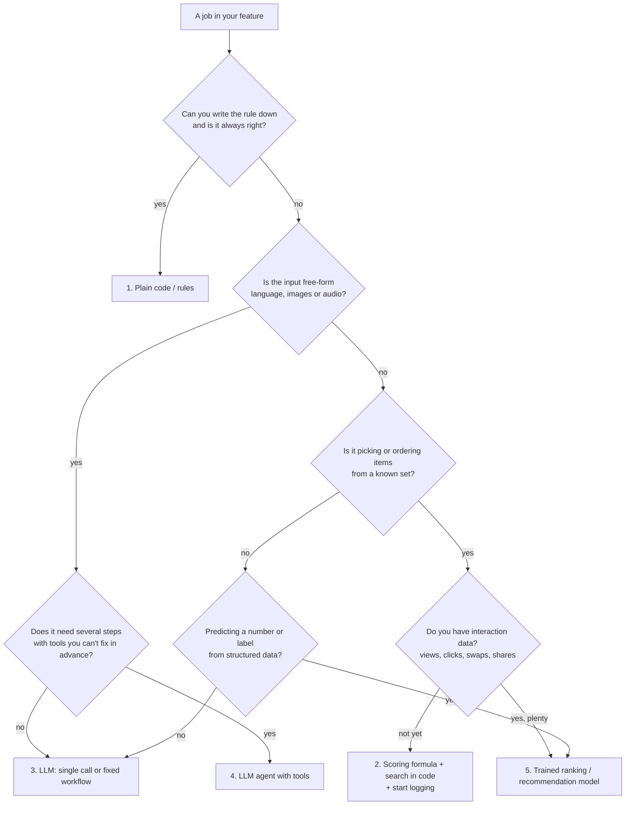

# Building AI features: the playbook

> How we decide **what kind of intelligence** a feature needs, and how to build it so it is fast, cheap, testable and gets better over time.
> Examples come from Yalla, but the rules apply to any AI product.

**Read next:** [Yalla AI review](yalla-review.md) (this playbook applied to our code) · [Data and recommendations](data-and-recommendations.md) (what to log, and when a recommendation engine makes sense)

---

## 1. Start from the job, not the model

"Add AI" is not a design. Before writing a prompt, split the feature into **jobs** and ask, for each one, _what is the cheapest thing that does this job well?_

Our PRD already does this for Yalla (jobs A to F in [PRD §5.2](../PRD.md#52-system-side-the-6-jobs)):

| Job                  | What it really is                                  | Best tool                                  |
| -------------------- | -------------------------------------------------- | ------------------------------------------ |
| A. Capture intent    | A form                                             | Code                                       |
| B. Understand intent | Messy text in 3 scripts → structured fields        | **LLM** (small model)                      |
| C. Fetch places      | Search over a database                             | **API** (Google Places)                    |
| D. Compose plans     | Pick stops that fit hours, time and driving limits | **Search algorithm** in code, with ranking |
| E. Write copy        | Short, warm, local wording                         | **LLM**                                    |
| F. Save and share    | Storage                                            | Code                                       |

The mistake to avoid is handing several jobs to one big prompt because it "works in the demo". You lose speed, cost control, testability and the ability to improve each job on its own.

---

## 2. The five tools, and when each one wins

| #   | Tool                                                   | Wins when                                                                                                   | Loses when                                                                 | Yalla example                                                                           |
| --- | ------------------------------------------------------ | ----------------------------------------------------------------------------------------------------------- | -------------------------------------------------------------------------- | --------------------------------------------------------------------------------------- |
| 1   | **Code / rules**                                       | The rule is known and must always hold: hours, budgets, time maths, geography                               | The input is fuzzy language                                                | "Never schedule a stop when it's closed"                                                |
| 2   | **Scoring + search** (no training)                     | Picking or ordering from a list, with no data yet                                                           | You have data and a fixed formula leaves quality on the table              | Rating adjusted for review count, + distance, + profile match → best valid 3-stop route |
| 3   | **LLM, single call or fixed workflow**                 | Understanding or generating language; taste; one-off extraction                                             | Exact facts, arithmetic, hard constraints, high volume at low latency      | "بدنا نتغدى بالبترون" → `{area: Batroun, slots: [Lunch]}`                               |
| 4   | **LLM agent** (model chooses tools in a loop)          | The steps can't be known in advance, mistakes are recoverable, and the value justifies the cost and latency | The steps are known. Then a fixed workflow is cheaper, faster and testable | Probably never in Yalla's request path                                                  |
| 5   | **Trained ML** (ranking, recommendations, classifiers) | You have many labelled examples or interactions and the pattern is statistical                              | Cold start, no data, or the rule is known                                  | "People who loved this brunch spot also loved…" (later)                                 |

### Rules of thumb

- **LLM proposes, code decides.** Let the model understand and suggest; let code check every hard fact (does it exist, is it open, does it fit the time) before a user sees it.
- **Never ask an LLM to do something you'll overwrite.** If code recomputes the times anyway, don't pay the model to compute them.
- **Workflow before agent.** If you can draw the steps as a fixed diagram, write them as code that calls the model at fixed points. Only reach for an agent loop when the path truly depends on what the model finds.
- **ML needs data; LLMs need examples.** A recommendation model with no interaction data is guesswork. An LLM with no eval set is also guesswork.

---

## 3. What LLMs are good and bad at

| Good at                                                                                       | Bad at                                               |
| --------------------------------------------------------------------------------------------- | ---------------------------------------------------- |
| Understanding messy language, typos, dialects, mixed scripts (Arabic, Franco-Arabic, English) | Arithmetic, time maths, distances                    |
| Pulling structured fields out of text                                                         | Following 15 hard rules at once, every time          |
| Writing short copy with a tone                                                                | Knowing which places exist or are open _today_       |
| Judging "taste" between a few good options                                                    | Picking from 150 candidates consistently             |
| Summarising, classifying, translating                                                         | Being cheap and fast at high volume with a big model |

The pattern that follows: **send the LLM small, focused tasks where language or taste matters, with the facts already checked by code.**

---

## 4. LLM harness patterns, simplest first

Pick the lowest rung that works. Each rung up adds cost, latency and things that can go wrong.

1. **Single call with structured output.** One prompt in, JSON checked against a schema out. Covers about 80% of product AI: parsing, extraction, classification, copy.
   _Yalla: parse the request; read a reel caption._
2. **Fixed workflow (chain).** Code calls the model at set points with code steps in between: parse → retrieve → rank → write.
   _Yalla: the target architecture in the [review](yalla-review.md#target-architecture)._
3. **Router.** A cheap call decides which path to take (for example, "is this a trip, a day out, or out of scope?").
4. **Tool-use agent.** The model decides which tools to call, in a loop, until done. Use only when all four hold:
   - **Complexity:** the steps can't be specified in advance.
   - **Value:** the outcome justifies the extra cost and latency.
   - **Viability:** the model is actually good at this kind of task.
   - **Recoverable errors:** mistakes can be caught and fixed (tests, review, undo).

   A consumer "plan my Saturday" screen with a 5-second goal fails the latency test. Keep agents for back-office work, such as curating a new city's starter list overnight.

### Every LLM call should have

- **A schema for the output** (Zod + the API's structured output), and code checks _after_ it for anything that matters.
- **A typed failure path**: out of credits, busy, refused, cut off, didn't match the schema. Each one maps to a clear message for the user, never a blank screen. `askJSON` in `src/lib/ai.server.ts` already does this well.
- **A time budget.** Decide the worst-case latency up front, counting retries.
- **A log line**: route, model, effort, prompt version, input/output tokens, cache hits, latency, stop reason. Without it you can't evaluate or reduce cost (see [data doc](data-and-recommendations.md#2-log-1-ai-calls)).
- **An eval set** before it ships (see §6).

---

## 5. Choosing a model

### The Claude lineup

Prices are per million tokens, as of November 2026. Check the Anthropic pricing page before budgeting.

| Model          | ID                  | Input | Output | Positioning              | Use it for                                                                                  |
| -------------- | ------------------- | ----- | ------ | ------------------------ | ------------------------------------------------------------------------------------------- |
| **Haiku 5.5**  | `claude-haiku-5-5`  | $0.10 | $0.50  | Fastest, cheapest        | Parsing, extraction, classification, routing, high-volume steps on the user's critical path |
| **Sonnet 5.5** | `claude-sonnet-5-5` | $2    | $10    | Balanced                 | Copy with tone, re-ranking a few options for taste, most product features                   |
| **Opus 5.5**   | `claude-opus-5-5`   | $4    | $20    | Strongest everyday model | Hard reasoning, LLM-as-judge in evals, generating test data, offline curation               |
| **Fable 5.1**  | `claude-fable-5-1`  | $10   | $50    | Most capable, long turns | Long agentic jobs and research. Not for a consumer request path                             |

_Haiku 5.5's price applies up to 100K-token prompts._

### How to choose

1. **Start with the model the eval says is good enough, not the one that feels safest.** Run the same eval set on Haiku, Sonnet and Opus (at low effort too). Keep the cheapest one that passes the hard checks.
2. **Effort is a dial within one model.** `output_config.effort` (`low` → `max`) trades depth for tokens and latency. Opus 5.5 defaults to `medium`. Always try a bigger model at **low effort** next to a smaller model before building a multi-model cascade. One model is simpler, and caches don't carry across models.
3. **Judge cost per finished task, not per request.** A cheap call that fails half the time and needs a retry isn't cheap.
4. **Offline work gets the Batch API**: about 50% cheaper and asynchronous. Use it for eval runs, LLM-as-judge grading and bulk enrichment such as writing descriptions for every place.
5. **Prompt caching** makes repeated _prefixes_ about 10× cheaper to read. Put stable content first (system prompt, few-shot examples, a city's place list) and anything that changes per request last. It only pays off when the stable prefix is large (roughly 0.5K–4K tokens minimum, depending on the model) and reused within minutes.
6. **Plan for refusals and outages.** On Opus, Sonnet and Fable, enable the server-side `fallbacks` option. Haiku has no server-side fallback, so handle `stop_reason: "refusal"` in code.

### Yalla's routes

| Route                      | Today                                     | Recommended starting point                                                                           | Why                                                  |
| -------------------------- | ----------------------------------------- | ---------------------------------------------------------------------------------------------------- | ---------------------------------------------------- |
| Parse request (job B)      | Keywords in code, plus the planner prompt | **Haiku 5.5**, low effort, structured output; move up to Sonnet only if the Arabic/Franco eval fails | Short input, short output, on the critical path      |
| Read reel caption          | Opus 5.5, low effort                      | **Haiku 5.5**                                                                                        | Simple name extraction                               |
| Build the plan (job D)     | Opus 5.5, medium effort, ~150 candidates  | **Code** (scoring + search); optional Sonnet re-rank of the top ~8                                   | Hard rules belong in code; the model only adds taste |
| Write copy (job E)         | Inside the planner call                   | **Sonnet 5.5** (or Haiku if it passes the tone check)                                                | Tone matters; input is just 3 fixed plans            |
| Grade evals (LLM-as-judge) | None                                      | **Opus 5.5** via the Batch API                                                                       | Offline, so accuracy matters more than cost          |
| Status ping                | Opus                                      | Haiku, or no LLM call at all                                                                         | It only needs to prove the key works                 |

---

## 6. Evals: how you know it works

No AI feature ships without an eval. Use three layers:

1. **Golden set (offline, in CI).** 30–100 real or realistic inputs, each with the ideal output and a list of **hard fails**. `evals/parser.golden.json` is a good example: it covers English, Arabic, Franco-Arabic, typos, prompt injection and impossible requests. Grade with code where possible (exact fields), and with an LLM judge plus a written rubric only for fuzzy parts like tone.
2. **Invariant checks (online, on every request).** Code that checks every output: every stop is open, inside the time window, under the drive limit, not in an avoided category. Count violations; they should be zero.
3. **Product metrics (online).** What users actually do: picked a plan, swapped a stop, shared it, opened a shared link. See the [data doc](data-and-recommendations.md).

Rules:

- **Change one thing, re-run the eval, compare.** Prompts, models and effort levels are all experiments.
- **Keep a held-out slice** you don't tune on, so you don't overfit the prompt to the golden set.
- **Add every production bug to the golden set.**

---

## 7. Guardrails

- **Prompt injection.** Anything the user or the web wrote (free text, captions, place descriptions, saved-reel data from the browser) is data, not instructions. Limit the damage: the model may only pick from ids we give it, and code checks the result.
- **Cost.** Rate limits per visitor _and_ a global daily budget. Alert on spend. Cap retries.
- **Latency.** Set a budget per route (for example, parse < 1.5 s, the whole plan < 5 s) and measure p50 and p95.
- **Privacy.** Log what you need to improve the product, with an anonymous id, and a retention period. No names, phone numbers or precise home locations in logs.

---

## 8. Checklist for a new AI feature

Copy this into the PR description.

- [ ] Jobs listed, each with its tool (code / search / LLM / agent / ML) and a one-line reason
- [ ] Hard facts and constraints checked in code, not by the model
- [ ] Model and effort chosen **from an eval run**, not by feel; cheaper options tried
- [ ] Output schema + code check after it; every failure type has a user message
- [ ] Latency budget and worst case with retries written down
- [ ] Golden set with hard fails, runnable in CI
- [ ] Logs: one AI-call log line per request + product events (impressions included)
- [ ] Cost: rate limit, retry cap, rough cost per request written down
- [ ] Injection: untrusted text marked as data; the model's output limited to safe choices
