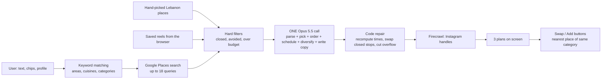
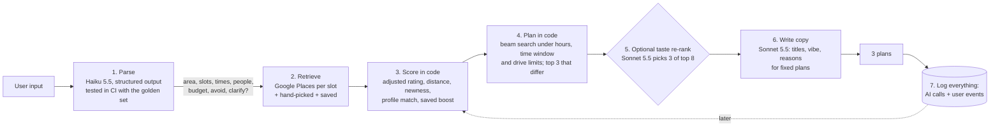

# Yalla AI review (November 2026)

> The [playbook](playbook.md) applied to our own code: what is built today, what's wrong with it, and where to take it.
> Written from an AI tech lead / ML staff point of view. Line numbers refer to the code at the time of writing.

## Summary

- The LLM earns its place in **two** jobs: understanding what users type (including Arabic and Franco-Arabic) and writing the copy.
- It is also doing a third job it's bad at: **scheduling the day** (times, opening hours, driving). Our code already contains most of a planner, but today it mostly fixes the model's mistakes after the fact.
- The job the PRD calls critical, **understanding the request**, is mostly English keyword matching in code. Arabic input doesn't steer the place search at all.
- **Nothing is logged**, so we can't evaluate, tune or ever train a recommendation model. Fixing that is the cheapest, most valuable step and should start now (see [data doc](data-and-recommendations.md)).
- A collaborative-filtering recommendation engine isn't possible yet. It becomes possible once we log interactions.

---

## 1. What's built today

### Layers

| #   | Layer                                                                                                                                                                                 | Where                                                                      | AI?     |
| --- | ------------------------------------------------------------------------------------------------------------------------------------------------------------------------------------- | -------------------------------------------------------------------------- | ------- |
| 1   | Input check (Zod)                                                                                                                                                                     | [`plans.functions.ts:33`](../../src/lib/plans.functions.ts)                | No      |
| 2   | Understanding the request: area names found in the text (`:139-141`), a fixed cuisine word list ([`live.server.ts:68-94`](../../src/lib/live.server.ts)), category words (`:205-213`) | `plans.functions.ts`, `live.server.ts`                                     | No      |
| 3   | Candidates: hand-picked list + Google Places text search per area × category, rating ≥ 4 and ≥ 25 reviews, 6-hour in-memory cache                                                     | [`places.ts`](../../src/lib/places.ts), `live.server.ts:96-208`            | No      |
| 4   | Hard filters: closed that day, avoided category, over budget                                                                                                                          | `plans.functions.ts:256-265`                                               | No      |
| 5   | **Building the plans: one Opus 5.5 call** at medium effort with up to ~180 candidates as JSON                                                                                         | `plans.functions.ts:313-349`, [`ai.server.ts`](../../src/lib/ai.server.ts) | **LLM** |
| 6   | Checking and repairing: Zod, recompute times, replace closed stops, cut overflow                                                                                                      | `plans.functions.ts:361-418`                                               | No      |
| 7   | Extras: Instagram handle via Firecrawl web search                                                                                                                                     | `live.server.ts:211-253`                                                   | No      |
| 8   | Swap / Add: nearest place of the same category, then rating                                                                                                                           | [`plans.tsx:217`, `:490`](../../src/routes/plans.tsx)                      | No      |

### AI use cases

| Use case    | Function                                                                 | Model            | What the model does                                                                            |
| ----------- | ------------------------------------------------------------------------ | ---------------- | ---------------------------------------------------------------------------------------------- |
| Build plans | `generatePlans`                                                          | Opus 5.5, medium | Everything in layer 5                                                                          |
| Read a reel | `readReel` ([`media.functions.ts:67`](../../src/lib/media.functions.ts)) | Opus 5.5, low    | Pulls the place name, area and dish from a TikTok/YouTube caption; Google then finds the place |
| Status ping | `aiStatus`                                                               | Opus 5.5, low    | Proves the key works; cached 5 minutes                                                         |

**What's done well:**

- All AI calls go through one wrapper (`askJSON`) with structured output, typed failure kinds and server-side fallback.
- The model may only use place ids from the candidate list, so it can't invent a place.
- The code checks opening hours after the model.
- A thoughtful golden eval set already exists.

---

## 2. Findings, most important first

### F1. The LLM schedules the day, and code overrides it

- The code recomputes every arrival time and keeps whichever is later, the model's or its own (`plans.functions.ts:381-382`).
- It swaps out stops the model placed at closed times (`:383-403`).
- It cuts stops past the end time (`:404`).
- The two disagree on drive time. The prompt says about 1.5 minutes per km (`:320`); the code uses `d*1.3/0.7`, about 1.86 minutes per km ([`places.ts:460`](../../src/lib/places.ts)). The code's plan therefore always runs later than the model's, which causes more swapped and cut stops.

**Why it matters:** we pay Opus to do arithmetic we then throw away. This is a classic routing problem: pick a few stops, each with opening hours, inside a time and driving budget. With 50–150 candidates and 2–5 stops, a simple beam search finds valid plans in milliseconds, and they are always valid.

### F2. Understanding the request is keyword matching

- The PRD plans an LLM step that turns the text into structured fields; the code doesn't have one.
- The Google search is driven by English substring matches. "بدنا نتغدى بالبترون" doesn't match "Batroun", so `areas` stays empty and the search falls back to Beirut and Batroun.
- [`evals/parser.golden.json`](../../evals/parser.golden.json) is a strong eval set (Arabic, Franco-Arabic, prompt injection, impossible requests), but the parser it tests doesn't exist and nothing runs it.

### F3. One large model for every route

- Reading a reel is simple name extraction and runs on Opus. Haiku is the natural fit.
- The planner is one Opus call with ~180 candidates as JSON in, 3 plans out. That makes the PRD's 5-second goal unlikely; we haven't measured it, so measure first.
- Worst-case latency is long. The SDK retries once (`ai.server.ts:12`), the loop tries twice (`plans.functions.ts:342`), and each call has a 60-second timeout.

### F4. Swap and Add ignore the rules (fixed)

Swap and Add picked the nearest place of the same category from `allPlaces()`. They didn't check opening hours, budget or diet (`plans.tsx:217-220`, `:490-492`). After the planner carefully repaired the plan, one tap could bring back a closed or non-halal place.

**Fixed in [PR #4](https://github.com/Ahmadtekritidx/Yala/pull/4).** Both now go through [`src/lib/alternatives.ts`](../../src/lib/alternatives.ts), which checks opening hours at the arrival time, avoided categories, budget and diet, with unit tests in `tests/alternatives.test.ts`. Live places found by a diet search on Google now carry a `diet` tag, so a vegan user's Swap only offers meals Google returned for "vegan". Still open: swapping one stop moves the arrival times of later stops, and those later stops aren't checked again. The page already warns "Closed at this time. Swap it?" when that happens.

### F5. Nothing is logged

- No record of prompts, outputs, tokens, cost, latency or stop reasons.
- No product events: which plan was picked, swaps, removals, shares, opened links.
- The profile and saves live only in the browser's storage.

We can't measure quality, compare a change against the current version, or train anything. Swaps and removals are free "this suggestion was wrong" labels, and today we throw them away.

### F6. Server memory is shared across users

- The `LIVE` place registry is shared by every visitor and fully cleared at 3000 places ([`places.ts:437`](../../src/lib/places.ts)).
- The Google search cache in `live.server.ts:7` is never cleaned up, and its keys include any world city name, so it can grow without limit.
- The rate limiter and caches live per server instance, so on serverless hosting they mostly reset.

### F7. Smaller issues

- Sunset times are hard-coded for Lebanon. Abroad, the model is asked to guess "local sunset". A sunset formula would be exact.
- "Prefer high rating with many reviews" is left to the model. Do it in code with a rating adjusted for review count (a Bayesian average), so 4.9 from 30 reviews doesn't beat 4.6 from 3,000.
- Saved-place text from the browser goes into the prompt. The damage is limited, because the model can only pick from the given ids and share links already carry any text anyone wants to put in.

---

## 3. Target architecture

| Step        | Tool                    | Latency target    | Notes                                                                                                                    |
| ----------- | ----------------------- | ----------------- | ------------------------------------------------------------------------------------------------------------------------ |
| 1. Parse    | Haiku 5.5               | < 1.5 s           | Output is the `schema` in `parser.golden.json`. Ask one clarifying question only when both area and activity are missing |
| 2. Retrieve | Google Places           | parallel, cached  | Driven by parsed slots, not keyword matching                                                                             |
| 3. Score    | Code                    | ms                | One formula; later replaced by a trained ranking model                                                                   |
| 4. Plan     | Code                    | ms                | Same rule checks reused by Swap and Add (fixes F4)                                                                       |
| 5. Re-rank  | Sonnet 5.5 (optional)   | < 2 s             | Only if A/B tests show it beats the scoring formula                                                                      |
| 6. Copy     | Sonnet 5.5 or Haiku 5.5 | < 2 s, can stream | It can't change places, only words                                                                                       |
| 7. Log      | DB / analytics          | async             | See [data doc](data-and-recommendations.md)                                                                              |

**What we get:** plans that always respect the rules, much lower latency and cost per plan, each step testable on its own, and a feedback loop that lets ranking improve with use. The LLM stays where it adds something only an LLM can: the Arabic and Franco-Arabic input, and the local tone.

---

## 4. Order of work

Each step is shippable on its own:

1. **Logging** (AI-call log + product events). Nothing else can be measured without it, and the data can't be collected after the fact. **Built (November 2026):** see [README](../../README.md#logging-and-shared-limits). It records once the database secrets are set.
2. ~~**Fix Swap / Add** to use the same hours, budget and diet checks as the planner (F4).~~ Done.
3. **Parser on Haiku** + run `parser.golden.json` in CI; drive the Google search from the parsed slots (F2). **The exam runs in CI now** (`npm run eval`). Today's keyword matching scores **15.6%** (5 of 32) with 5 hard fails, which is the floor the AI parser must beat. It also shows a live bug: "no hiking" adds hikes to the search instead of avoiding them (item 23).
4. **Move reading reels and the status ping to Haiku** (F3).
5. **Score + plan in code**; the LLM writes copy only. A/B test against the current planner on picked-plan and share rates (F1).
6. **Shared cache / rate limit** in a real store (F6). **Built:** rate limits, the Google search cache and the Instagram cache use the same database; the Instagram cache in memory is now capped. Still per server: the `LIVE` place registry.
7. **Ranking model, then recommendations**, once data volume allows (see [data doc](data-and-recommendations.md#4-the-ladder-from-no-data-to-collaborative-filtering)).
